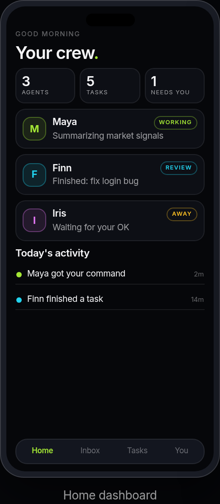
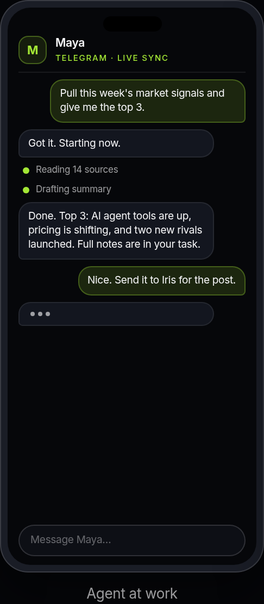
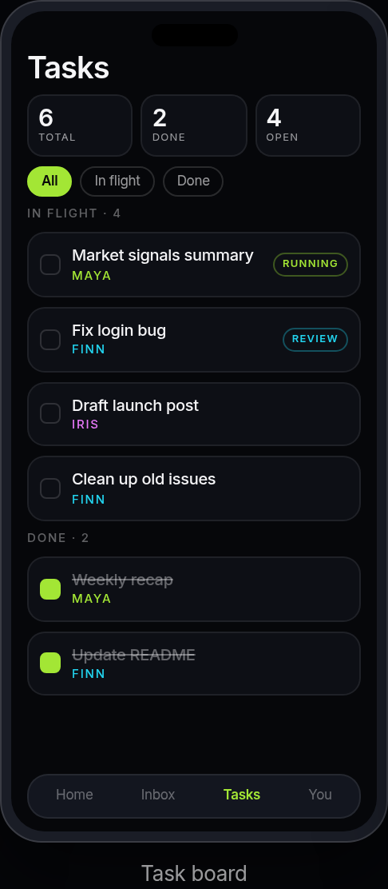
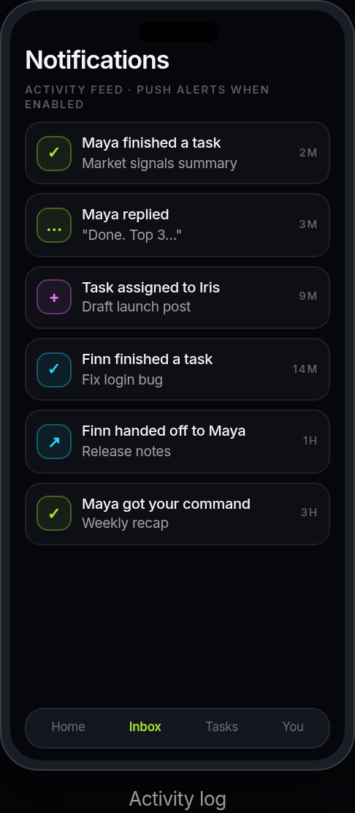

# AgentHQ

**A phone-first control center for people who already have an AI agent.**
Connect it, give it a job, and see whether it finished or needs your help.

[Project landing page](https://agent-qh.vercel.app) | Built for [LA Hacks 2026](https://la-ai-hackathon-2026.devpost.com) at UCLA

## The problem

If you run an AI agent through Telegram, Discord, or anywhere else, chat apps only show you the final result. You never see what the agent is doing while it works, what is still on its plate, or that it quietly broke ten minutes ago. Its messages also get buried under everyone else's texts.

## What we are building toward

The goal is a second front door into an agent you already own and run elsewhere. AgentHQ is being built to give the agent a place to report status, progress, and errors in real time, and give you a place to send it commands, without digging through a chat thread.

- **See live work:** status, progress, and failures from your agent in one place.
- **Send commands:** hand your agent a job and watch it get acknowledged and completed.
- **Stay in control:** tasks, memory, handoffs, and workspaces organized per agent.
- **Get alerted:** push notifications when something needs you.

### Core principle

Our design rule: AgentHQ should never think for the agent. The agent's intelligence stays wherever it already runs. AgentHQ is a window and a remote control, not a replacement brain. The command/report path follows that rule; the legacy chat cleanup is still under review.

## Design previews

Design previews from the project website, not live app screenshots. Real captures will follow a verified phone demo.

| Home dashboard | Agent at work | Task board | Activity log |
| :---: | :---: | :---: | :---: |
|  |  |  |  |

These mockups show the intended interface, not verified live agent activity. The agent-at-work view illustrates messages and progress from an external agent; it does not mean AgentHQ supplies the agent's intelligence.

## Current status

AgentHQ is an in-progress prototype, with app code and a command/report foundation in `main`. It is not a finished live agent-control demo yet.

### Implemented in the repo

- Expo app screens and data access for agents, tasks, memory, handoffs and workspaces.
- A "Give it a job" panel with command status, progress, report history, results and a stale-agent warning.
- Backend code for issuing an agent key, creating commands, letting an external agent claim them, and recording acknowledgments, progress, results or errors.
- Automated tests for the command/report flow using the real handlers against an in-memory backend emulator.

### Still in progress

- The command/report foundation is emulator-tested only. It has not been deployed or verified with a real external agent or on a phone.
- A runnable external-agent connector and its setup/key flow still need to be completed and tested.
- Supabase migrations, access policies and functions need to be checked against the live project before deployment. Do not apply them blindly.
- Stop marks a command cancelled in AgentHQ. It does not yet prove the external agent stops executing.
- Retry/recovery and production hardening remain follow-up work.
- Legacy in-app chat and OpenAI code are still in `main`. [PR #2](https://github.com/Badbunny21/AgentQH/pull/2) proposes removing the client-side path; it is not merged.

### The hackathon slice

Connect one existing agent, send one real command from a phone, and show it acknowledge, report progress, then finish or fail with a visible report history. The work is the real connection and reliable demo, not building a new AI brain. Teammate ideas that make that slice clearer and stronger are welcome.

The [project landing page](https://agent-qh.vercel.app) introduces the concept. It is not proof of a working external-agent connection. Real app screenshots will be added after the phone demo is verified.

## Tech stack

- **App:** Expo / React Native with TypeScript (one codebase for iOS and Android)
- **Backend:** Supabase (Postgres, Auth, Edge Functions)
- **Integrations:** Telegram, Discord, Stripe, push notifications
- **Website source:** Next.js in `website/`; the public Vercel landing is a separate standalone deployment.

## Project structure

```
.
├── App.tsx              App entry point
├── src/
│   ├── components/      Reusable UI components
│   ├── constants/       Theme, plans, templates, demo data
│   ├── contexts/        React context providers (auth, agents, tasks, workspaces)
│   ├── lib/             API clients, including commandsApi.ts for commands/reports
│   ├── navigation/      Navigators and tab bar
│   ├── screens/         App screens
│   └── types/           Shared TypeScript types
├── supabase/
│   ├── functions/       Edge Functions (imports, sync, billing, legacy chat)
│   │                    Command/report: agent-key-issue, agent-commands-create,
│   │                    agent-commands-poll, agent-report and shared protocol
│   └── migrations/      Database schema migrations
├── tests/               Command protocol + emulator command/report tests
├── website/             Marketing site (Next.js)
└── docs/                Setup guides
```

## Quick start

These are the current `main` instructions. [PR #4](https://github.com/Badbunny21/AgentQH/pull/4) proposes the portable Node 22 setup and Windows instructions; it is still awaiting review. Current start/Android/iOS scripts use macOS shell commands, so use that PR as the setup review point before onboarding a Windows teammate. The command/report tests need Node 22.13+; Node 18 is not enough for that test command.


**Prerequisites:** Node.js 18+, npm, and the [Expo Go](https://expo.dev/go) app or an iOS/Android simulator.

```bash
git clone https://github.com/Badbunny21/AgentQH.git
cd AgentQH
npm install
cp .env.example .env
```

Edit `.env` and fill in your own Supabase project values:

| Variable | Purpose |
| --- | --- |
| `EXPO_PUBLIC_SUPABASE_URL` | Your Supabase project URL |
| `EXPO_PUBLIC_SUPABASE_ANON_KEY` | Your Supabase anon (public) key |
| `EXPO_PUBLIC_OPENAI_API_KEY` | Optional, local development fallback only |

Never commit `.env` or any real keys. `.env` is already in `.gitignore`.

Then start the app:

```bash
npm start          # Expo dev server on your local network
npm run start:tunnel   # Use this if your phone is on a different network
npm run web        # Run in the browser
```

Database migrations live in `supabase/migrations/`. Review them against your project before applying them with the [Supabase CLI](https://supabase.com/docs/guides/cli). Do not push migrations blindly to an existing project. Billing setup is covered in [docs/STRIPE_SETUP.md](docs/STRIPE_SETUP.md).

### Website

```bash
cd website
npm install
npm run dev
```

## Built for LA Hacks

AgentHQ is our entry for LA Hacks 2026 (October 17-18, UCLA). The demo goal: connect an existing agent, send it one command, watch it acknowledge and report progress, then finish or fail visibly with an audit trail.

## Team

Team: Julieth Avina - founder. Product, app, and agent integration.

## License

Released under the [MIT License](LICENSE).
